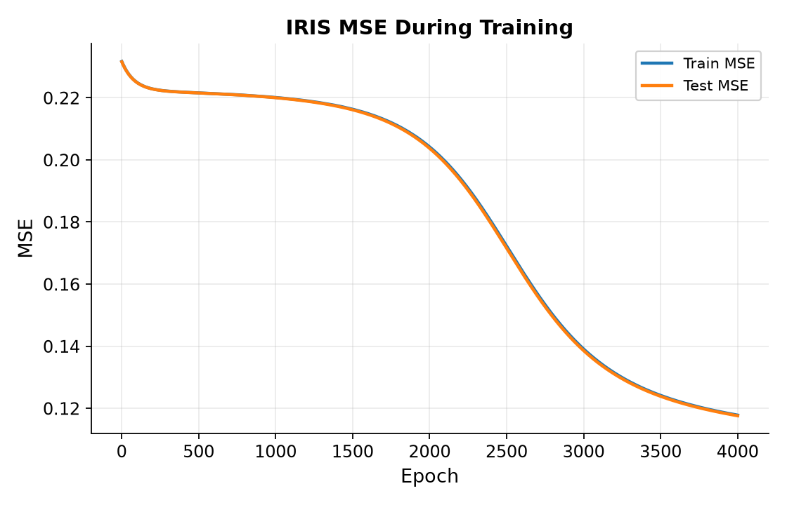
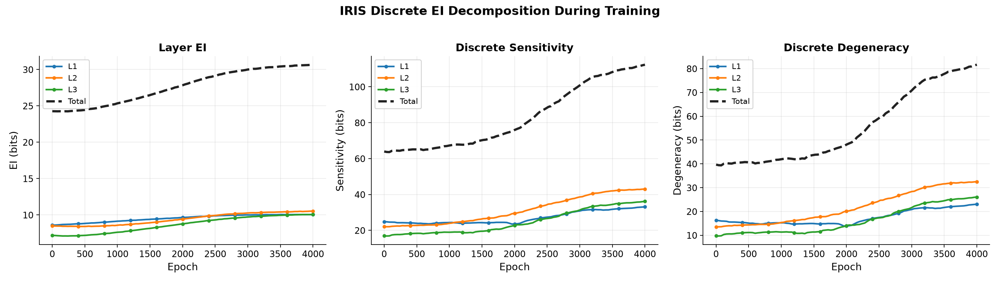
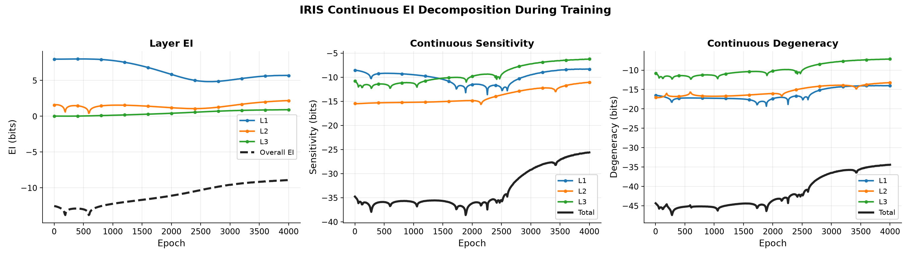
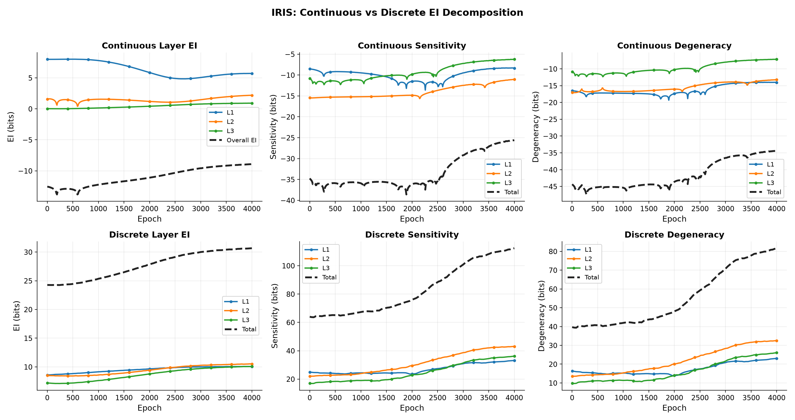
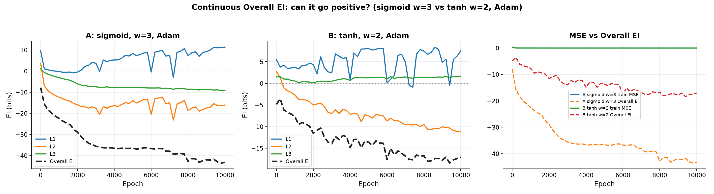
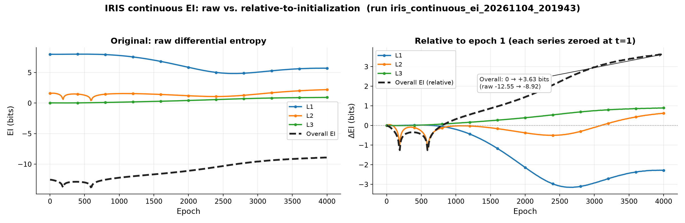

# 神经网络有效信息（EI）计算原理：连续法与离散法

> 面向对象：不熟悉神经网络、但需要判断这套指标是否可信的读者。
> 阅读顺序建议：先看第 0 节的全景图，再按 1→2→3→4 走一遍，最后看第 6 节的误区。

**一句话概括**：训练把 60 个数字（权重）调好；EI 就是拿这 60 个数字当"被测对象"，
往里灌随机数、看输出怎么变，用两种不同的方式估计"输入与输出之间共享了多少信息"。

---

## 0. 全景图：EI 实验只有三个零件

| 零件 | 是什么 | 是否随方法变化 |
|---|---|---|
| **被测对象** | 训练好的 60 个权重构成的函数 $f$ | 两种方法完全相同 |
| **实验条件** | 对输入做均匀随机"注入"，采样 3 万组 | 完全相同 |
| **估计器** | 怎么从"输入样本 + 输出样本"算出互信息 | **离散法 vs 连续法** 的唯一区别 |

所以"同一个数据集为什么能算两种"是个伪命题：**两种方法量的都是同一个函数，只是用两把不同的尺子量它**。数据集只参与训练，不参与测量。

---

## 1. 第一步：60 个权重是怎么来的

### 1.1 网络就是一个 60 个数字的表格

```
4 个输入  →  第一层 5 个神经元 ：4×5 = 20 个权重
          →  第二层 5 个神经元 ：5×5 = 25 个权重
          →  输出层 3 个       ：5×3 = 15 个权重
                                合计 60 个（没有 bias）
```

除此之外，网络里**什么都没有**——没有规则、没有记忆、没有查表。训练前这 60 个数是随机初始化的（第一层 ±0.5、后两层 ±0.447）。

### 1.2 训练：把 60 个旋钮拧到合适位置

| 项目 | 取值 | 人话 |
|---|---|---|
| 数据 | IRIS 150 朵花，120 训练 / 30 测试 | 每朵 4 个测量值，3 个品种 |
| 目标 | one-hot，如 [1,0,0] | 三个输出各代表一个品种的得分 |
| 损失 | MSE（预测与答案之差的平方取平均） | 评分标准，0 最好 |
| 更新 | 每次按梯度反方向挪一小步，步长 0.01（SGD） | 往"误差变小"的方向拧旋钮 |
| 批次 | 每 10 朵算一次平均误差，然后更新一次 | 每轮更新 12 次 |
| 轮数 | 4000 轮 | 共 48,000 次更新 |

训练完成后，这 60 个数固定下来，网络就变成一个**确定的函数**：给任何输入，输出唯一。



*图 1｜4000 轮训练：MSE 0.2317 → 0.1178，测试曲线未上翘，没有明显过拟合。此时准确率约 68%/70%、平均置信度 0.62——**它还没完全收敛**（训到 20000 轮时 MSE 0.0158、准确率 97.5%）。这一点很重要：后面的 EI 曲线描述的是"训练中途"的结构变化，不是"训练完成"的状态。*

### 1.3 一次前向：从 4 个数到 3 个数

每一层做两件事：**加权和**，再过 **sigmoid**。

- 加权和：$z = Wx$（60 个权重里的某一行乘输入再求和）；
- sigmoid：$a = 1/(1+e^{-z})$，把任意大的数压进 (0,1)。

以花 `[4.4, 3.0, 1.3, 0.2]` 为例：

| 层 | 数值 |
|---|---|
| L1 的加权和 z | [0.20, −0.97, −2.775, 2.922, −2.523] |
| L1 的输出 a | [0.55, 0.275, 0.059, 0.949, 0.074] |
| L2 的输出 a | [0.235, 0.19, 0.889, 0.614, 0.372] |
| L3 的输出 a | [0.831, 0.180, 0.077] → 判为第 0 类 ✅ |

**从这一刻起，请把网络看成一个"函数"，而不是一个"模型"**：它不再学习，只是一遍遍地做加权和 + sigmoid。

---

## 2. 第二步：EI 到底在问什么

### 2.1 定义

$$\mathrm{EI} = I(X;Y)\ \big|\ do\big(X \sim U(\Omega)\big)$$

翻译成人话：**把输入当成"均匀乱灌的随机数"，问输出能被区分出多少种状态、这些状态有多少是由输入决定的**。

- 如果不管输入怎么变，输出永远是同一个值 → EI = 0；
- 如果输入和输出一一对应 → EI 最大。

### 2.2 为什么必须"随机注入"，而不是喂训练数据

因为 EI 描述的是**函数本身**，不是某批样本的统计：

- 换一批数据、权重不变 → EI 一点都不变；
- 只有权重变了，EI 才变。

这也是为什么测量要用"最大熵干预"：均匀分布代表"所有可能的输入"，不偏袒任何一批花。

### 2.3 一个具体画面

测量时：随机生成 30,000 组 4 个数 → 每一组都过一遍那 60 个权重 → 得到 30,000 组 5 个输出数。EI 就是"这 3 万对输入/输出之间共享了多少信息"。

**接下来的两种方法，就是两种"统计这 3 万对数据"的方式。**

---

## 3. 离散法（论文原方法）：数格子

### 3.1 逻辑链路

```
随机输入 3 万组
   ↓
每一组过网络，得到对应的输出
   ↓
① 把输入、输出都"分箱"：把 0~1 切成 32 段，落在第几段就记成几号
   ↓
② 把多个数拼成一个整数编号（输入编号 C、输出编号 E）
   ↓
③ 统计 (C, E) 的联合频次表
   ↓
④ 由频次表算出概率 p(c)、p(e)、p(c,e)
   ↓
⑤ EI = Σ p(c,e)·log₂[p(c,e) / (p(c)·p(e))]
```

### 3.2 一个样本的完整旅程

```
输入 x = [0.774, 0.439, 0.859, 0.697]
  分箱 → [24, 14, 27, 22]
  拼编号 → C = 24 + 14×32 + 27×32² + 22×32³ = 749016

输出 y = [0.404, 0.546, 0.429, 0.249, 0.756]
  分箱 → [12, 17, 13, 7, 24]
  拼编号 → E = 25409068
```

于是一条样本被压缩成一对整数：`(C=749016, E=25409068)`。重复 3 万次，就得到一张"哪个 C 对应哪个 E、出现了多少次"的表。

**为什么这样拼**：需要一个唯一编号才能"数频次"。输入有 4 个数、每数 32 档，所以输入编号有 $32^4=1{,}048{,}576$ 种可能；输出有 5 个数，输出编号有约 3355 万种可能。

### 3.3 从频次表到 EI

互信息可以写成两个熵的差：

$$\mathrm{EI} = H(E) - H(E\mid C)$$

- $H(E)$：输出的**多样性**（3 万个输出编号散得有多开）；
- $H(E\mid C)$：知道输入之后，输出还剩多少**不确定**。

前馈网络是确定映射，所以 $H(E\mid C)$ 理论上接近 0，EI 就几乎等于"输出有多多样"。

### 3.4 Sensitivity 与 Degeneracy

EI 是"两条路一起上"时的总信息量。为了看清"每条路各自的贡献"和"路与路之间的干扰"，再定义两个量：

| 量 | 怎么算 | 直觉 |
|---|---|---|
| **Sensitivity** | **每次只让一个输入变化**、其余固定为 0，把每个"输入 i → 输出 j"的互信息都算出来再求和 | 每条通道单独看有多灵敏 |
| **Degeneracy** | Sens − EI | 多条通道一起上的时候，有多少信息被"重叠/合并"掉了 |



*图 2｜离散法（bins=32、每 40 轮测一次、每次 3 万样本）。左：三层 EI 与总和；中：Sensitivity；右：Degeneracy。*

**实测（4000 轮）**：

| 指标 | L1 | L2 | L3 | 合计 |
|---|---|---|---|---|
| EI | 8.59 → 10.06 | 8.50 → 10.52 | 7.18 → 10.08 | **24.27 → 30.66** |
| Sensitivity | 24.89 → 33.13 | 22.08 → 43.03 | 16.99 → 36.16 | **63.96 → 112.32** |
| Degeneracy | 16.30 → 23.07 | 13.58 → 32.51 | 9.81 → 26.08 | **39.69 → 81.66** |

### 3.5 这个方法的坑：格子太多、样本太少

L1 的输入编号有 104 万种，却只灌了 3 万组随机数。实测结果：

| bins | 实际出现的编号数 | 只出现 1 次的 | $H(E\mid C)$ | EI |
|---|---|---|---|---|
| 8 | 4,093 | 18 | 0.657 | 3.58 |
| 16 | 23,988 | 18,853 | 0.145 | 6.86 |
| **32** | 29,542 | **29,088（98.5%）** | **0.011** | 10.05 |

只出现一次的编号，你**没法观察**"同一个输入会不会产生不同输出"，于是 $H(E\mid C)$ 被算法压成 ≈0，EI 几乎等于 $H(E)$。

所以：

- "H(E|C) ≈ 0 说明网络是确定映射"——方向没错，但**这个 0 里有很大一部分是采样不足造成的**；
- 离散 EI 的**绝对值随 bins 和样本数变**（3.58 / 6.86 / 10.05），只有趋势可信；
- 论文用 10⁷ 样本，就是为了把格子填满。

---

## 4. 连续法（本项目的解析近似）：算体积

### 4.1 换个思路：不分箱，给输出加噪声

连续变量取到"某个精确值"的概率是 0，所以没法数频次。连续法的做法是：

1. 给输出加一个高斯噪声模型：$Y = f(X) + \varepsilon$，$\varepsilon\sim\mathcal N(0,\sigma^2)$；
2. 用这个模型**解析地**算出 $H(Y\mid X)=H(\varepsilon)$；
3. 用网络的**导数**（雅可比）推算 $H(Y)$。

$$\mathrm{EI}=\frac{1}{n_{\text{in}}}\Big[\underbrace{-\tfrac12 n_{\text{out}}\log_2(2\pi e\sigma^2)}_{\text{term1：确定性}}+\underbrace{H(X)}_{\text{注入宽度}}+\underbrace{\mathbb E\log_2\mathrm{pdet}J}_{\text{体积项}}\Big]$$

三项的含义：

| 项 | 含义 | 什么时候变正/变大 |
|---|---|---|
| **term1** | 输出有多**确定**（噪声越小越确定） | σ 越小 → term1 越大 |
| **H(X)** | 注入区间的"宽度" | 本项目 w=1，所以恒为 0 |
| **体积项** | 这一层把输入空间**拉伸还是压扁** | 拉伸（pdet>1）为正，压扁（pdet<1）为负 |

### 4.2 体积项怎么算

网络在一点附近的"局部拉伸倍数"由雅可比矩阵描述：

$$J = \mathrm{diag}\big(a'(z)\big)\cdot W$$

- $W$ 是这一层的权重；
- $a'(z)$ 是 sigmoid 的导数，**最大只有 0.25**；
- 把 $J$ 做奇异值分解，所有奇异值相乘 = 体积倍数（伪行列式 pdet）。

sigmoid 的导数上限 0.25 意味着：**每一维最多放大 0.25 倍，多个维度一乘就迅速趋于 0**。所以 sigmoid 层天生"压扁"，体积项几乎必然为负。

### 4.3 两套 σ，千万别混用

| | 逐层 σ（彩色层线） | Overall σ（黑虚线） |
|---|---|---|
| 来源 | 该层反传梯度的标准差 | 输出残差（预测−答案）的标准差 |
| 层间 | 每层不同（0.0022 / 0.0044 / 0.0228） | 三层共用一个（0.342） |
| 与 MSE | 无直接关系 | **≈ √MSE**（实测比值 0.991~1.000） |

因为 Overall 换了尺子，它**不是**三层 EI 相加：4000 轮时三层相加是 +9.59，Overall 却是 −12.55。

### 4.4 结果



*图 3｜连续法（每 10 轮测一次、每次 2000 样本）。左：三层 EI + Overall；中：Sensitivity；右：Degeneracy。*

| | L1 | L2 | L3 | Overall |
|---|---|---|---|---|
| EI（4000 轮） | 7.99 → 5.70 | 1.57 → 2.19 | 0.02 → 0.92 | **−12.55 → −8.92** |
| EI（20000 轮） | 2.36 | 1.91 | 1.71 | **−4.18** |

### 4.5 为什么 Overall 是负的

三个原因叠加：

1. **微分熵可以为负**。香农熵（离散）恒非负，但微分熵（连续）的零点依赖单位/尺度，没有"非负"约束。
2. **负值主要来自体积项**。4000 轮时体积项贡献 −7.49 bits，而 term1 只贡献 −1.43 bits。
3. **局部线性近似低估了 $H(Y)$**。sigmoid 强饱和时，"把网络当线性"这个假设失效，$H(Y)$ 被算小，减法就出负数。

一个硬证据：**σ→0 时 term1→+∞，EI 会发散到 +∞**。互信息不可能无穷大，说明这套公式的"零点/标度"依赖 σ，它是一个近似量，而不是严格的互信息。

---

## 5. 两种方法放在一起



*图 4｜上排连续法（除以输入维度），下排离散法（原始 bits）。注意两排纵轴量级和符号都不同，只能比较趋势。*

| | 离散法 | 连续法 |
|---|---|---|
| 估计互信息的方式 | 分箱 + 直方图（香农熵） | 高斯噪声 + 雅可比体积（微分熵） |
| 需要的原料 | 权重 + 随机样本 + bins | 权重 + 随机样本 + σ |
| 自由参数 | bins（决定曲线幅度） | σ（决定曲线零点） |
| 符号 | 恒非负 | 可为负 |
| 逐边分解 | 可以（Sensitivity） | 可以（逐边雅可比） |
| 主要风险 | 采样不足导致 $H(E\mid C)$ 失真 | 饱和导致体积项被低估 |
| 可比性 | **趋势可比；绝对值、符号不可比** | |

**共同结论**（两种方法都复现了）：

- 训练先让 **Sensitivity 上升**（通道变灵敏）；
- 随后 **Degeneracy 加速上升**（通道互相重叠）；
- 所以 **EI 只小幅增长**——网络在"做减法"，只保留对分类有用的信息。

---

## 6. 误区专章（你之前反复问的那些）

> 这一节是全篇最重要的部分。每条都是"表面上像 A，实际上是 B"，并附上证据。

### 误区 1：「EI 是用训练数据算出来的」

❌ 以为：EI 是在评估模型在 IRIS 上的表现。
✅ 实际：EI **完全不碰训练数据**。测量时灌的是随机数，数据只负责训练出权重。
📌 证据：换一批数据、权重不变，EI 一个数都不会变。

### 误区 2：「每训练一轮就测一次 EI」

❌ 以为：4000 轮就有 4000 个测量点。
✅ 实际：连续法每 **10 轮**测一次（401 个点），离散法每 40 轮测一次（101 个点）。测量只是"读权重、做前向"，不影响训练。
📌 类比：训练是练功，测量是每周称一次体重。

### 误区 3：「同一个数据集，为什么既能算离散又能算连续」

❌ 以为：离散/连续是两种"数据形态"。
✅ 实际：它们只是**两把尺子**。被测量的对象（那 60 个权重）完全相同，输入分布也相同，区别只在"怎么从样本估计互信息"。
📌 类比：同一杯水，摄氏 20° 和华氏 68°，量的是同一杯水。

### 误区 4：「离散和连续的数值可以换算/相加」

❌ 以为：24.27 bits 和 −12.55 bits 应该能对上。
✅ 实际：不能。离散用香农熵（恒非负、以"格子"为尺度），连续用微分熵（可负、零点任意）。**符号都可能相反**（离散 Deg 恒正、连续 Deg 恒负）。
📌 只能比"趋势"：两边都是"敏感度先涨、冗余后涨、EI 小涨"。

### 误区 5：「H(E|C) ≈ 0 证明前馈网络是确定映射」

❌ 以为：这是网络性质的有力证据。
✅ 实际：**一半是采样造成的假象**。3 万样本对 104 万个输入编号，98.5% 的编号只出现一次，"条件不确定"根本无从观察。
📌 证据：bins 从 8 加到 32，H(E|C) 从 0.657 掉到 0.011——网络没变，是格子变细了。

### 误区 6：「Overall EI 和三层 EI 差那么多，一定是算错了」

❌ 以为：Overall 应该等于 L1+L2+L3。
✅ 实际：**Overall 换了 σ 重算**（用输出残差取代逐层梯度 std），是一个不同的量；中层、右层的黑线才是"三层相加"。
📌 证据：4000 轮时三层相加 +9.59，Overall −12.55，差 22 bits 全部来自 σ 的替换。

### 误区 7：「EI 是负的，说明互信息算错了」

❌ 以为：互信息天然非负，算出负数一定是 bug。
✅ 实际：公式没错，但**它算的不是互信息**，而是"微分熵之差"，零点依赖 σ。真互信息恒 ≥ 0，而这里的量可以任意负。
📌 证据：σ→0 时它发散到 +∞——真互信息不可能无穷大。

### 误区 8：「把 MSE 压下去，EI 就能变正」

❌ 以为：σ 小 → term1 大 → EI 正。
✅ 实际：**实测相反**。用 Adam 把 MSE 从 0.118 压到 0.0056，Overall EI 从 −8.92 掉到 **−43.25**。
📌 原因：降 MSE 需要权重变大 → sigmoid 饱和 → 体积项崩塌，损失是指数级的，term1 的收益是对数级的。



*图 5｜左/中：两种配置下 Overall EI 随训练下降；右：MSE 一路降到 0，Overall EI 却一路掉到 −35 以下。*

### 误区 9：「换激活函数只是换个非线性，影响的是数值」

❌ 以为：只动了一个公式符号。
✅ 实际：激活决定了三件事——① 导数上限（sigmoid 0.25、tanh 1、ReLU 0/1）；② 输出取值范围（决定离散法的分箱区间）；③ 训练轨迹（梯度不同 → 权重不同 → σ 不同）。
📌 同一组权重下，w=2 时 sigmoid 的 EI 是 −0.165、tanh 是 +1.81、ReLU 是 +2.27。

### 误区 10：「w（注入宽度）只是公式里的一个常数，改了只是平移」

❌ 以为：改 w 只影响 $H(X)=\log w$ 那一项。
✅ 实际：改 w 会**同时改变采样值**，于是 $z=Wx$ 变了、饱和程度变了、体积项也变了。净效果是"部分抵消"。
📌 证据：w 从 1 增到 3，理论上 +1.585 bits/层，实测只有 +1.13~+1.41。

### 误区 11：「训练越久，EI 越高」

❌ 以为：性能越好，信息传得越多。
✅ 实际：不一定。20000 轮时 Overall 确实从 −12.55 升到 −4.18，但 **L1 的 EI 从 7.99 掉到 2.36**（因为梯度 σ 变大），体积项也只改善了 0.65 bits。
📌 "训练"同时改两件相反的事：σ 变小（利于 term1）与权重变大（不利体积项）。

### 误区 12：「体积项衡量的是网络学得好不好」

❌ 以为：体积项负得多，说明网络差。
✅ 实际：体积项衡量的是"这一层把输入空间压扁了多少"，和分类性能**没有单调关系**。sigmoid 层天生压扁（$a'\le0.25$），所以再好的网络也可能是大负值。
📌 4000→20000 轮，MSE 从 0.118 降到 0.016，体积项只从 −7.49 改善到 −6.84。

---

## 7. 如果一定要 EI 为正

| 方案 | 得到的数 | 代价 |
|---|---|---|
| **零点平移**：$EI(t)-EI(1)$ | 0 → +3.63 bits | 是"差值"，不是 EI 本身 |
| **换 $H(Y)$ 的估计**（kNN 熵，Kozachenko–Leonenko） | 逐层 +4.31/+2.67/+1.16 bits；Overall ≈ +0.15 bits | 改估计方式，需重算全部曲线 |
| **离散法** | 24 → 31 bits，恒非负 | 不能逐边分解、绝对值随 bins 变 |

三条路对应三种取舍：**要"非负且是 EI" → 选 kNN；要"和论文口径一致" → 选离散；只要图面好看 → 零点平移。**



*图 6｜零点平移：每条曲线减去自己在 epoch 1 的取值，Overall 从 0 涨到 +3.63 bits。*

---

## 8. 名词表

| 名词 | 一句话解释 |
|---|---|
| 权重 | 60 个可调数字，决定每条连接的强弱 |
| 神经元取值 | 某一层那排 0~1 的输出数 |
| 分箱 | 把 0~1 切 32 段，用"第几段"代替小数 |
| 编号（C / E） | 把多个分箱结果拼成一个整数，方便数频次 |
| 互信息 | 两个变量共享的信息量，单位 bit |
| term1 | 连续法里"输出有多确定"的那一项 |
| 体积项 | 连续法里"这一层把空间压扁多少"的那一项 |
| 雅可比 | 网络在一点附近的局部"拉伸矩阵" |
| 奇异值 / pdet | 拉伸矩阵的各方向倍数；连乘就是体积倍数 |
| σ | 噪声尺度；逐层用梯度 std，Overall 用残差 std |
| Sensitivity | 每次只扰动一个输入时，各通道的信息量之和 |
| Degeneracy | Sensitivity − EI，通道重叠/冗余 |

---

## 9. 本文数字的来源

| 内容 | 位置 |
|---|---|
| 连续版分解图与 CSV | `results/latest/iris_continuous_ei/` |
| 离散版分解图与 CSV | `results/latest/iris_discrete_ei/` |
| 两法对照图 | `results/latest/iris_continuous_vs_discrete.png` |
| 单边玩具系统 | `results/latest/figure1_ei_decomposition/single_edge_ei.png` |
| MSE 与 EI 反向的证据 | `results/updates/overall_positive.png` |
| 零点平移版本 | `results/updates/ei_decomposition_relative.png` |
| 公式推导全文 | `experiment_figures_20261022.html` §1 |

> 说明：图片使用相对路径，请在项目目录内用支持 Markdown 预览的编辑器（如 VSCode）打开本文档，否则图片无法加载。
